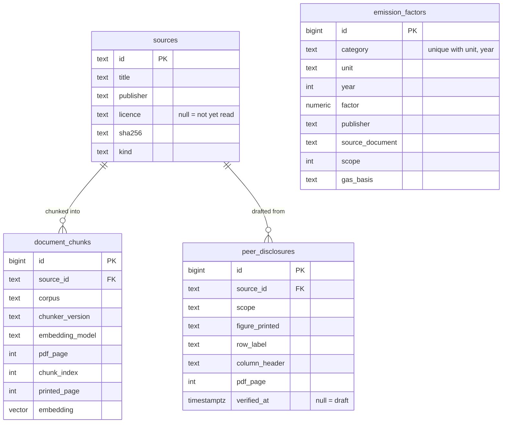

# Data

Every dataset Carbon R uses: where it comes from, under what licence, how it is refreshed,
what it cannot be trusted for, and whether it is in the repo. Verification status per value
is in [SOURCES.md](SOURCES.md); this file is the inventory and the data dictionary.

**Nothing third-party is committed.** Source documents live in git-ignored `data/raw/`;
the repo holds their provenance, their sha256 and the code that reads them.

## Datasets

| Dataset | Source | Licence | Retrieved | Refresh | In the repo | Known limits |
|---|---|---|---|---|---|---|
| Singapore grid emission factor, 2005–2024 | EMA, *Singapore Energy Statistics 2025*, Table 2.4 | Not yet read from EMA's terms | 2026-10-15 | EMA publishes in arrears, once a year; re-read the new SES table and update the literals in `scripts/seed_factors.py` | Values as literals; the workbook is local | CO₂ only (not CO₂e); location-based; the newest year trails the current year by about two |
| LPG, diesel, petrol factors, 2025–2026 | DESNZ, *UK GHG Conversion Factors for Company Reporting*, sheet `Fuels` | Open Government Licence v3.0 | 2026-10-18 | DESNZ publishes each June; add the year to `scripts/load_desnz_factors.py`, then `make verify-desnz` against the workbook | Values as literals; workbooks local | **UK, not Singapore**; no back series, so a 2024 fuel activity has no factor; diesel/petrol rows rest on an unverified biofuel assumption (docs/SOURCES.md §9) |
| GHG Protocol Corporate Standard (2004), Scope 2 Guidance (2015), Scope 3 Standard (2011) | WRI / WBCSD, ghgprotocol.org | Corporate and Scope 3: copyright, no licence granted; Scope 2: CC BY-NC-ND 3.0; site terms prohibit public reproduction and data mining | 2026-10-16, 2026-10-16, 2026-10-22 | Not refreshed: the ingest refuses a file whose sha256 differs from the registry, so a new edition is a deliberate change | **No.** Registry entries and hashes only; chunks live in the ingesting machine's database | Local use only; permission from GHG Protocol not yet requested (docs/SOURCES.md §2–3a) |
| Peer sustainability reports, 12 STI companies (14 files) | Each issuer, via its site or SGXNet; list in `data/peer_sources.json` | Copyright of each issuer; local use only | Downloaded by the author before 2026-10-23 | Per report year; a new year is a new entry with its own sha256 | **No.** Metadata only (`data/peer_sources.json`); registry rows built from it; chunks live in the ingesting machine's database (`scripts/ingest_peer.py`) | Self-reported, differing boundaries; non-calendar years (MPACT, MLT, FLCT); OCBC reports 2024 financed emissions; CICT is FY2024. Searched by `search_peer_disclosures` as prose only: PDF text layers fuse footnote markers onto table figures, so no figure is taken from them. MPACT, Sembcorp, CICT and both data books cite PDF pages (no confirmed page offset) |
| Verified peer emissions figures: 58 rows, 3 reports (DBS, CLAR ESG data pack, Sembcorp) | Drafted by a vision model from page images of those reports, each checked by the author against the cited page (`verification.verified_at` per row) | Facts taken from each issuer's report, with page citations; the reports themselves are not redistributed | Checked 2026-10-29 | When more pages are drafted and verified: `scripts/peer_disclosures_file.py export` | **Yes:** `data/peer_disclosures_verified.json`, the only tracked file holding real peer figures; seeded with `make seed-peer` | As self-reported by each company; **not independently assured**; differing boundaries and periods. Own-period column only. Transcription measured (57 of 58 as drafted, 1 label corrected; blind 12 of 12); skipped rows not measured |
| synthgen v1 documents (198) and answer keys | Generated by `carbon_r.synthgen`, seed `20261016` | Ours | — | Regenerated by `make docs`; frozen by `tests/fixtures/synthgen_v1_digest.json` | Generator, seed and digest; the documents themselves are git-ignored | Synthetic; four layouts, one held out; see docs/synthgen/SYNTHGEN_SPEC.md |
| Company-year scenarios (21 scenarios, 676 documents) | Generated by `carbon_r.synthgen.scenario`, seed `20261020` | Ours | — | `make scenarios` | Generator and seed | Synthetic; USD invoices are not converted |
| Methodology retrieval key (48 questions) | Drafted by reading the three standards | Ours (questions); anchors are hashes of GHG Protocol text | 2026-10-22, revised 2026-10-23 | Versioned in the file (`version`); revisions logged in docs/blocks/TIER2_BLOCK4.md | Questions, pages, hashes. Anchor quotes are local (`data/evals/local/`) | Written by one person; 6 questions per cell |

The hosted database used in development is Supabase in region `ap-northeast-1` (Tokyo),
which adds roughly 70 ms per query for a Singapore-focused app. A fresh clone does not use
it: `docker compose up` runs its own Postgres.

## Data dictionary

### `emission_factors` — migrations 0001, 0002

Queried by exact SQL only, never by similarity (ADR 0001). Identity: `(category, unit, year)`.

| Column | Type | Meaning |
|---|---|---|
| `id` | bigserial | Surrogate key |
| `category` | text | What is measured, e.g. `electricity_grid_sg`, `fuel_diesel` |
| `factor` | numeric ≥ 0 | The factor value, as published |
| `unit` | text | The publisher's own unit string, verbatim (`kg CO2 / kWh`) |
| `year` | integer | The year the factor applies to |
| `publisher`, `source_document`, `source_url`, `retrieved_at` | text, date | Provenance; all NOT NULL |
| `source_page` | text | Page, table or sheet reference |
| `jurisdiction` | text | `SG`, `UK`, …; non-SG is disclosed on every result |
| `verified` | boolean | True only when read from the publisher's primary document |
| `scope` | smallint | GHG Protocol scope, 1–3 |
| `method` | text | e.g. `location-based`, `combustion` |
| `gas_basis` | text | `CO2` or `CO2e` |
| `notes` | text | Free text |

### `sources` — migration 0003

The registry of every document read. Literals in `src/carbon_r/sources.py`, plus the 14 peer
reports built from `data/peer_sources.json` (`src/carbon_r/peer_sources.py`).

| Column | Type | Meaning |
|---|---|---|
| `id` | text PK | e.g. `ghgp_scope2`, `desnz_2026` |
| `title`, `publisher`, `year`, `url` | text, integer | What it is and where it was obtained |
| `licence` | text, nullable | As read from the publisher; null = not yet read |
| `retrieved_at` | date | When the local copy was obtained |
| `sha256` | text | Of the local file; an ingest refuses different bytes |
| `kind` | text | `methodology`, `factor_dataset` or `peer_report` |
| `verification_status` | text | `verified from primary` or `secondary only` |
| `printed_page_offset` | integer, nullable | PDF page minus printed page, where constant. Peer reports: set only where one offset in −2..+2 matches at least 80% of the pages with a readable footer number |
| `notes` | text | Free text |

### `document_chunks` — migrations 0004, 0005

The only table searched by similarity (ADR 0002). Identity:
`(source_id, chunker_version, embedding_model, pdf_page, chunk_index)`.

| Column | Type | Meaning |
|---|---|---|
| `id` | bigserial | Surrogate key; the judge cites chunks by it |
| `source_id` | text FK → `sources.id` | The document |
| `corpus` | text | `methodology` or `peer` |
| `chunker_version` | text | Hash of the chunk parameters; every search filters on it |
| `embedding_model` | text | The model that embedded the row; every search filters on it |
| `pdf_page`, `chunk_index` | integer | Position; a chunk never spans a page |
| `printed_page` | integer, nullable | Footer page number, only where the footer confirms it |
| `section` | text, nullable | Unused (heading detection proved unreliable) |
| `text`, `content_sha256` | text | The stored passage; every quote is verified against it |
| `embedding` | vector(1536) | `text-embedding-3-small` |
| `company`, `sector`, `report_year` | nullable | Peer reports only; null for methodology. `report_year` is the calendar year in which the report's period ends (MPACT and MLT, April to March, are 2026) |
| `tsv` | tsvector, generated | Keyword leg of `search_peer_disclosures` (GIN index, migration 0005) |

### `peer_disclosures` — migration 0006

Emissions figures from peer reports, one row per table cell, **LLM-drafted from page images
and counted only once verified by hand** (CLAUDE.md rule 4, the peer exception). Code reads
`peer_disclosures_verified`, the view of rows with `verified_at` set. Identity:
`(source_id, pdf_page, drafted_row_label, column_header)`. Drafted by
`scripts/draft_peer_disclosures.py`, verified by `scripts/verify_peer_disclosures.py` from the
author's git-ignored worksheet; a re-draft never overwrites a verified row. The verified
rows - and only those - are committed in `data/peer_disclosures_verified.json`
(`scripts/peer_disclosures_file.py export`), and `make seed-peer` loads them into a fresh
database: insert if missing, leave if identical, stop on a row that differs.

| Column | Type | Meaning |
|---|---|---|
| `source_id` | text FK → `sources.id` | The report |
| `company`, `period_start`, `period_end` | text, date | From `data/peer_sources.json`, never from the model. Only the report's own period column is drafted |
| `scope` | text | `1`, `2`, `3`, or a combined total as printed (`1+2`, `1+2+3`); nothing is summed |
| `scope3_category` | smallint, nullable | 1–15, only where printed |
| `figure_printed` | text | As printed, footnote markers left out |
| `figure` | numeric, nullable | `figure_printed` parsed in Python (commas stripped, never rescaled); null if it is not a plain number |
| `drafted_figure_printed` | text | What the drafting model read; kept when a row is corrected |
| `unit` | text | As printed; never converted |
| `method` | text, nullable | `location` or `market`, only where the page states it, on a row that includes Scope 2 |
| `pdf_page`, `printed_page` | integer | The page rendered; printed page only where the report has a confirmed offset |
| `row_label`, `column_header` | text | As printed: the evidence a reviewer checks against the page. `row_label` may be corrected by the author |
| `drafted_row_label` | text | The label as the model read it; never corrected, so it identifies the row |
| `notes` | text | Footnote markers, stated method wording, parse problems |
| `drafted_by`, `drafted_at`, `draft_request_hash`, `page_image_sha256` | text, timestamptz | Which model read which image, under which request |
| `blind_sample` | boolean | In the seeded sample checked blind before sighted |
| `verified_by`, `verified_at`, `verification` | text, timestamptz, text | Null on a draft; set together. `verification` is `confirmed`, `corrected` or `rejected` (rejected rows are left out of the view) |
| `blind_figure_printed` | text, nullable | The author's reading of a blind-sample row, made before seeing the draft; stored, never used to correct it |

## ER diagram

`emission_factors` is deliberately unconnected: its provenance is carried per row, NOT NULL,
and a factor is never reached through a passage.
