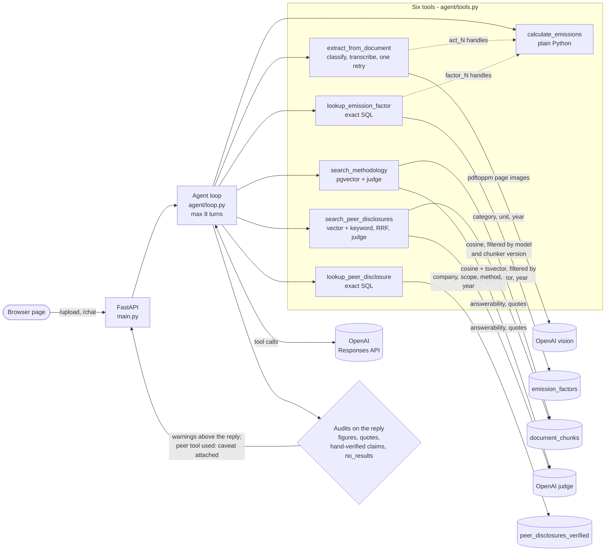

# Architecture

One FastAPI process, one Postgres database, one model provider. The model chooses tools and
transcribes; Python does every calculation; audits check the reply and warn above it when it fails.

What the diagram encodes:

- **Handles, not values.** `calculate_emissions` receives `act_N` and `factor_N` handles
  into the session, never a number typed by the model (dotted arrows).
- **Two retrieval paths that never cross.** Factors come by exact SQL
  ([ADR 0001](adr/0001-exact-sql-for-factors.md)); methodology prose comes by similarity
  ([ADR 0002](adr/0002-postgres-pgvector.md)), and so do peer-report passages. Nothing from
  either search can enter a calculation.
- **Peer passages are prose, never figures.** Their PDF text layers fuse footnote markers
  onto table numbers, so the figure audit refuses any number in the agent's own words that
  only peer text could have supplied, and the tool withholds table-like quotes (cited by
  page only). Peer figures come only from `lookup_peer_disclosure`: exact SQL on the view
  of rows verified by hand against the report page.
- **The peer caveat is code, not prose.** When a turn used a peer tool, the loop appends
  the fixed self-reported / not-assured sentence after the audits have read the model's
  words.
- **The audits run on every reply.** A number no tool produced, a quoted span no tool
  returned, "verified by hand" without a figure looked up in that turn, and a search's
  `no_results` the reply does not admit are listed on the response, put into words as
  `warnings` shown above the reply, and logged. They warn; they do not block.

Deployment shape (`docker compose up`): an `app` container (this process, plus the loaders
that seed the factors on start) and a `db` container (`pgvector/pgvector:pg17`).
