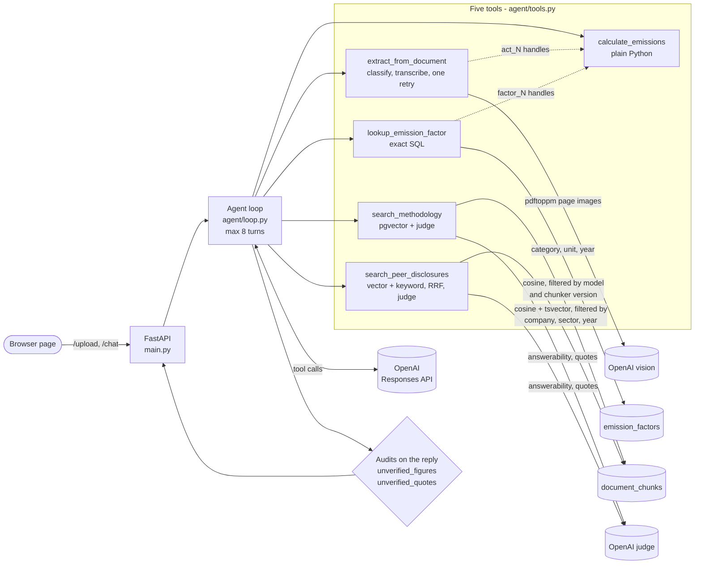

# Architecture

One FastAPI process, one Postgres database, one model provider. The model chooses tools and
transcribes; Python does every calculation; two audits check the reply before it is shown.

What the diagram encodes:

- **Handles, not values.** `calculate_emissions` receives `act_N` and `factor_N` handles
  into the session, never a number typed by the model (dotted arrows).
- **Two retrieval paths that never cross.** Factors come by exact SQL
  ([ADR 0001](adr/0001-exact-sql-for-factors.md)); methodology prose comes by similarity
  ([ADR 0002](adr/0002-postgres-pgvector.md)), and so do peer-report passages. Nothing from
  either search can enter a calculation.
- **Peer passages are prose, never figures.** Their PDF text layers fuse footnote markers
  onto table numbers, so the figure audit refuses any number in the agent's own words that
  only peer text could have supplied, and the tool withholds table-like quotes (cited by
  page only).
- **Both audits run on every reply.** A number no tool produced, or a quoted span no tool
  returned, is listed on the response and shown on the page.

Deployment shape (`docker compose up`): an `app` container (this process, plus the loaders
that seed the factors on start) and a `db` container (`pgvector/pgvector:pg17`).
